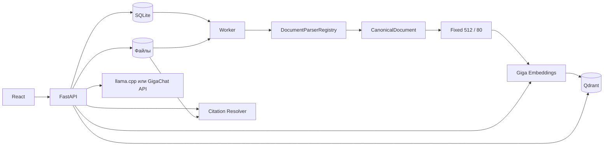

# Архитектура

FastAPI принимает документы и запросы. SQLite и файловое хранилище общие для FastAPI и отдельного Python worker. Process embeddings держит одну загруженную модель и обслуживает worker и backend через HTTP. React использует версионированный API. Поисковое ядро работает без frontend.

Worker создаёт новый UUID поколения для каждой попытки. Он записывает canonical и чанки в Qdrant, затем одной транзакцией SQLite переключает указатель активного поколения и закрывает задание. Retrieval включает фильтр разрешённых поколений. При повторной обработке прежнее поколение остаётся доступным до переключения. При удалении документ скрывается транзакцией SQLite до фоновой очистки хранилища.

Поиск выполняется в одной логической версионированной коллекции чанков. Dense использует cosine, BM25 ранжирует полнотекстовое поле, RRF выполняется в Qdrant. Backend удаляет идентичные фрагменты и применяет мягкое ограничение разнообразия. Контекст строится в границах окна провайдера. Resolver сверяет фрагмент с canonical, проверяет идентификаторы и формирует безопасные ссылки.

Исходный код находится в `backend/app`, worker в `backend/worker`, embeddings в `backend/inference`, React в `frontend/src`. Конфигурация и эксплуатационные скрипты находятся в `configs`, `deployment` и `scripts`.
